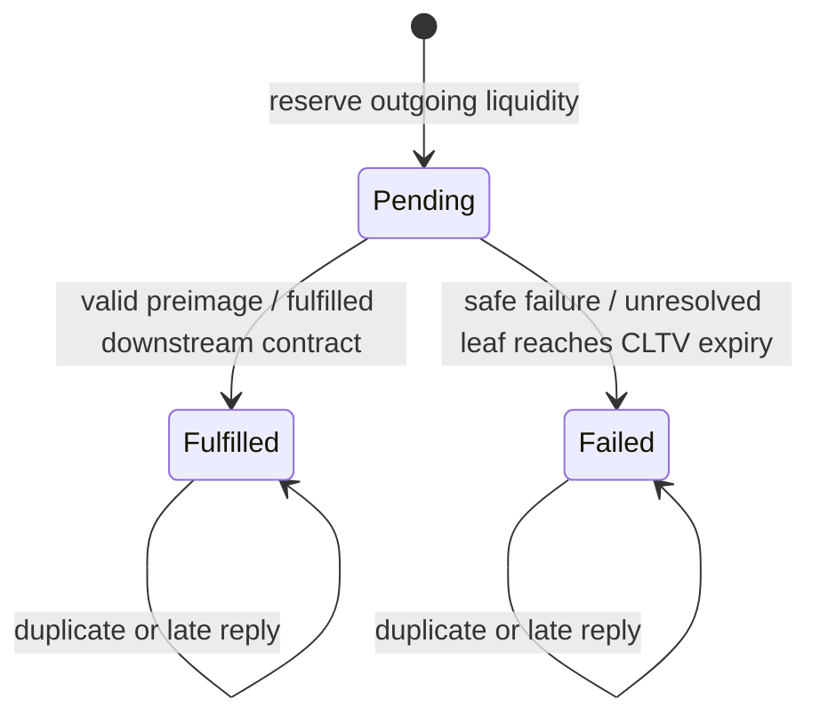

# HTLC resolution in the shared-channel simulator

UltraViolet resolves HTLCs through the same core for terminal routing, DSE, managed batches and direct Java callers. An unresolved host watchdog is distinct from an HTLC that expires in simulated block time.

## Model boundary

The chosen model retains UV's authoritative shared `UVChannel` objects. The new `HTLCResolution` ledger records irreversible outcomes for individual channel contracts. It abstracts the channel agreement/timeout-resolution mechanism: it does not implement commitment signatures, force-close transactions, confirmation/reorganization races or channel removal. P2P processing can stop while shared chain observation continues. This is a high-level simulation contract, not interoperable Lightning or a claim of full BOLT/on-chain fidelity.

Before this change, a sender timeout either released only the first-hop reservation (original main) or invalidated the whole run (the first consistency commit). A sender now waits for a definitive contract outcome. The clock resolves expiry and propagates an already-known downstream outcome even if a message-processing worker is stopped. A host/clock stall or interruption still fails conservatively; it never fabricates a protocol failure.

## Identity and transitions

A contract is keyed by `(channel ID, HTLC ID)`. Channel HTLC IDs are allocated monotonically across both directions and survive settled snapshots; exhaustion raises an error instead of wrapping. Contract metadata checks sender/receiver, hash, amount and expiry. Forwarding links an incoming contract to exactly one outgoing contract with the same hash, a non-increasing amount and an earlier expiry.

Terminal transitions release the reservation exactly once. Fulfillment also transfers the amount under the same channel lock. An incoming forwarded contract cannot fail while its outgoing contract is pending; a fulfilled outgoing contract requires upstream fulfillment, including when its reply arrives after an earlier waiting deadline. Expiry processes leaves before ancestors, and a known fulfillment is never overwritten by expiry. At the exact expiry height, a still-pending leaf can no longer be newly fulfilled. The check reads the committed clock height while arbitrating the transition, so a stale height read by a worker cannot bypass the boundary.

Normal P2P fulfillment/failure and block observation reconcile node-local pending maps and receipts from this ledger. Completed queued messages become obsolete and cannot revive a resolved contract. Terminal records retain scalar metadata for the lifetime of the network, preventing delayed replies from acting on a retry with the same invoice hash. They do not retain onion packets. Large runs therefore have a per-contract history memory cost; compaction is not implemented.

The existing sequential route-attempt model remains: an invoice retries only after the previous first-hop contract has reached a terminal state, which requires downstream resolution. A retry on the same first-hop channel gets a new HTLC ID. A successful payment is not retried. The payment hash alone is never used to apply a reply to a channel transfer.

## Clocks, reporting and persistence

- CLTV expiry uses simulated block height. Settled expiry increments `attempt_failed_timeout`; it can be followed by a successful route retry. Incoming offers that are already too late can instead fail with `expiry_too_soon`.
- `htlc_stall_timeout_ms` defaults to `15000`. The effective inactivity watchdog is the maximum of that setting, two configured block intervals, and eight per-hop service ticks. It uses monotonic elapsed time and resets on block progress. It measures a stalled simulator, not how long an HTLC may exist in protocol time.
- A watchdog or interruption preserves unresolved state and reports an infrastructure exception. Pause/save/export/resume reject an unhealthy run. Batch exceptions remain distinct from ordinary unsuccessful payments.
- The global pending ledger participates in `unsettledState`, in addition to node queues/reservations and active task accounting. Successful capture/save still requires the shared drain/join boundary.
- Only settled states are persisted. Transient pending contracts are not restorable; terminal ledger records can be discarded on a valid load because no live messages are serialized and channel HTLC counters persist. Original clean snapshot compatibility remains tested.
- New batch receipts include `htlc_resolution: "uv-shared-channel-htlc-v1"`. The optional research verifier accepts resolved timeout counters under this contract and still rejects timeout counters in historical receipts lacking it. No frozen receipt or experiment output is upgraded in place.

Settlement timing and retry outcomes can differ from earlier builds. Record this source version and model contract when producing new results; do not relabel old datasets as having used it.

## Regression evidence

`tests/HTLCResolutionTest.java` controls delivery and block advancement using small temporary fixtures. It covers:

- an unresponsive recipient, downstream expiry, complete reservation release and successful save/export of the failed payment;
- fulfillment committed before expiry with deliberately delayed/duplicate replies, including intermediary reimbursement and fees;
- expiry followed by a successful retry on the same first-hop channel, with stale fulfill/fail messages and duplicate adds;
- a block advancing between a worker's earlier observation and its attempted fulfillment;
- opposing concurrent payments sharing a channel, with exact balance and commitment-count checks;
- a stopped-clock watchdog preserving unresolved state and refusing export;
- managed batch accounting with ordinary resolved timeouts.

The full regression suite also exercises terminal subprocess commands, DSE route/inv/load, direct payment calls, snapshot compatibility and research adapters. These fixtures establish the listed invariants, not exhaustive verification of every possible interleaving or full Lightning protocol fidelity.
